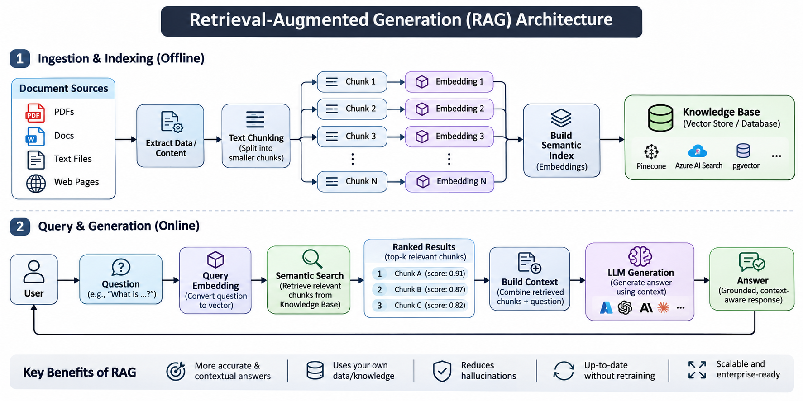

# 2. RAG Architecture.
1. Ingestion
2. Retrieval
3. Generation

Retrieval - Obtaining the data from DB.  
Augment - enhancing info using instructions or Prompt.  
Generation - Generation using LLM.

